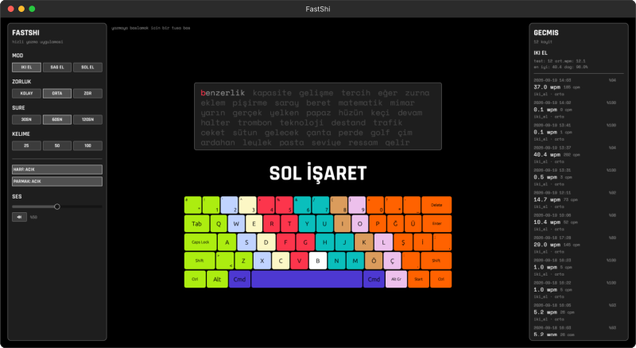

<h1 align="center">FastShi</h1>

<p align="center">Turkish QWERTY touch-typing trainer with timed tests, one-hand modes and local history.</p>

## Screenshots

<p align="center">
  
</p>

## Features

- Timed tests of 30, 60 or 120 seconds and word-goal tests of 25, 50 or 100 words
- Two-hand, right-hand-only and left-hand-only practice modes
- Three difficulty levels that filter the built-in Turkish word list
- Live WPM, CPM, accuracy and correct/wrong key counters
- On-screen keyboard with next-key and finger guidance
- Click and space sounds with an adjustable volume control
- Local SQLite history with per-mode summaries and the last 50 results
- Native desktop app built with Rust, egui and SQLite

## Installation

Build and run from source:

```bash
git clone https://github.com/colgecen/FastShi.git
cd FastShi
./fastshi --install
```

`--install` is a one-time step that lets you type `fastshi` (no `./`) to open the build menu:

```bash
fastshi
```

Prebuilt binaries are available on the [Releases](https://github.com/colgecen/FastShi/releases) page.

## Usage

Run the app straight from source (press `Ctrl+C` to stop):

```bash
./fastshi
```

Choose a mode, difficulty and session length from the left panel, then start typing the highlighted Turkish words. The next finger is shown above the on-screen keyboard; the right panel keeps your recent results. Results are stored in `~/.local/share/typing_trainer/stats.sqlite`.

## License

This project is licensed under the [MIT](LICENSE) license.
